## 📊SQL Retail Data Analysis Project
This repository contains a comprehensive **SQL Retail Data Analysis Project** designed to extract actionable business insights from retail sales datasets using advanced SQL queries, database modeling, and structured presentation slides.

---

## 📌 Project Overview
The primary objective of this project is to model, query, and analyze retail transactions, customer behaviors, product performance, and sales trends. By leveraging structured SQL queries and relational database schemas, the project answers core business questions related to revenue drivers, customer segmentation, and inventory optimization.

---
## 🛠️ Key Analytical Features

* **Relational Schema Design:** Structured table relationships connecting customers, products, orders, and payment dimensions.
* **Sales & Revenue Trends:** Tracking overall sales performance, monthly trends, and revenue growth drivers.
* **Customer Behavior Analysis:** Evaluating customer purchasing patterns using dimension tables.
* **Product & Inventory Insights:** Identifying key product performance metrics through structured relational queries.

### Main Dashboard Preview

### Presentation Slides (Slide 1 - Slide 12)

  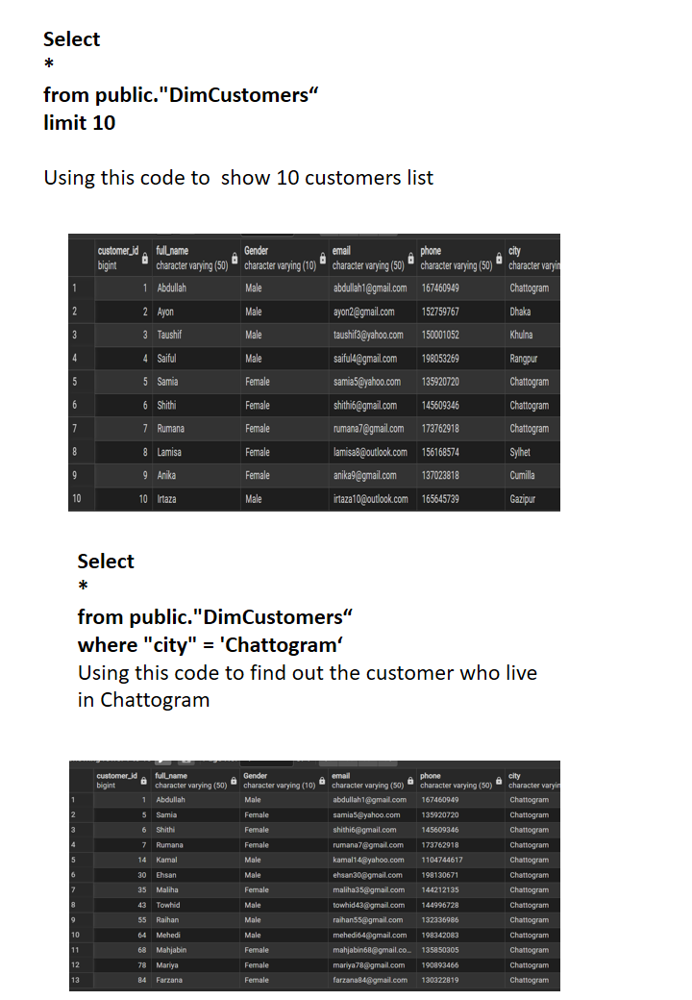
  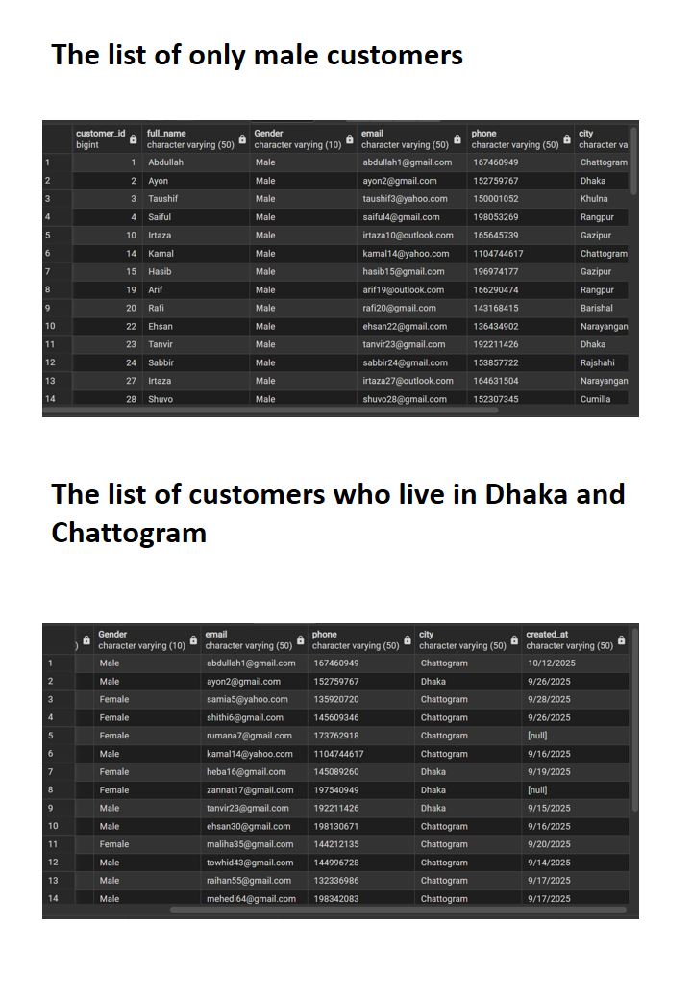
  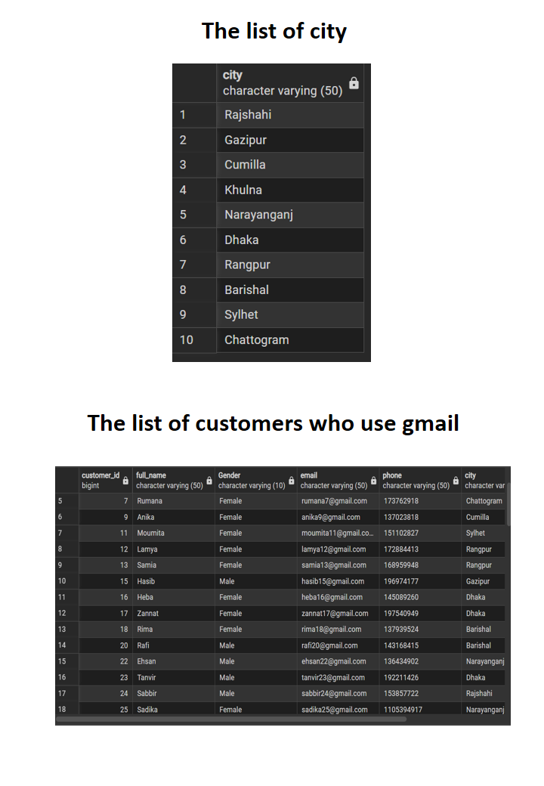
  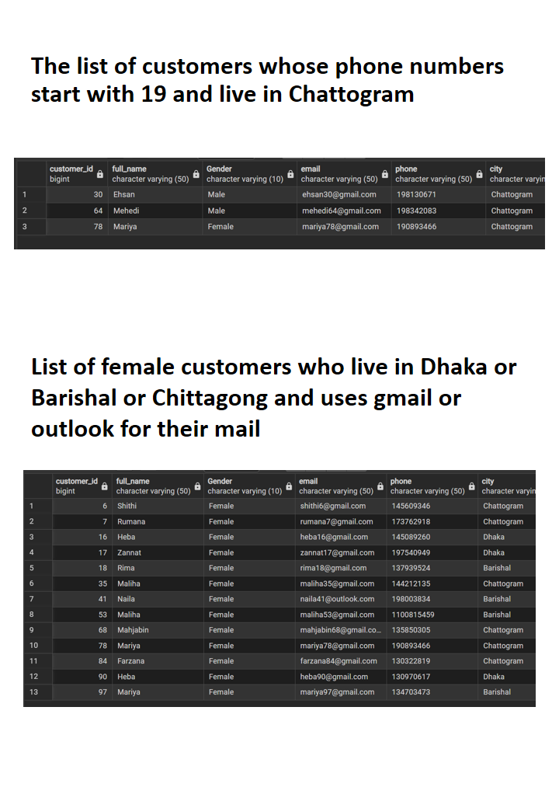
  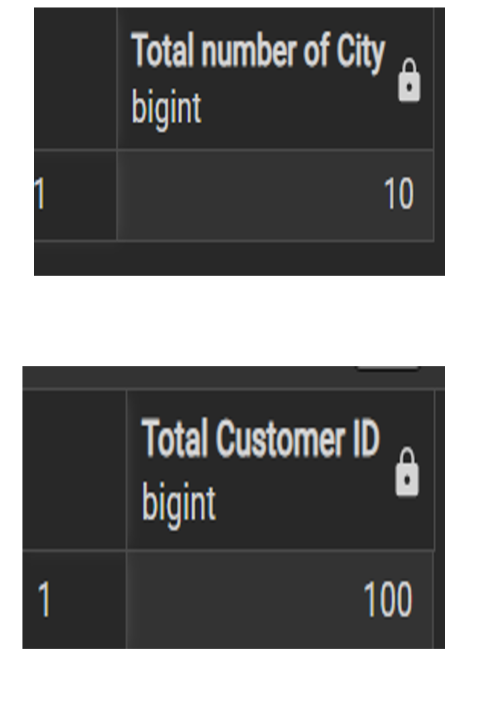
  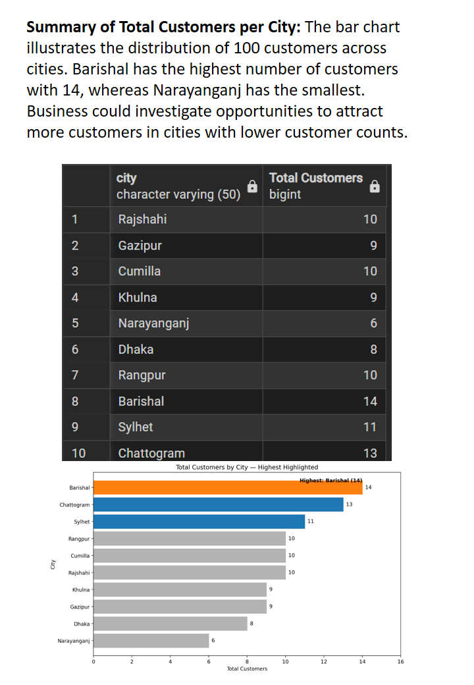
  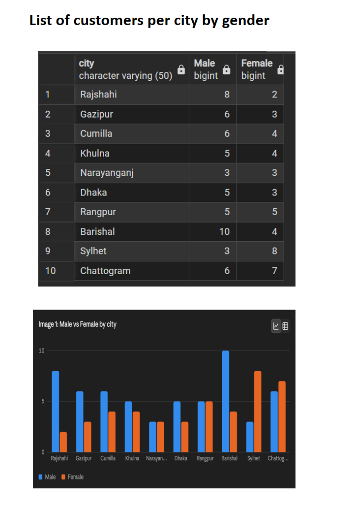
  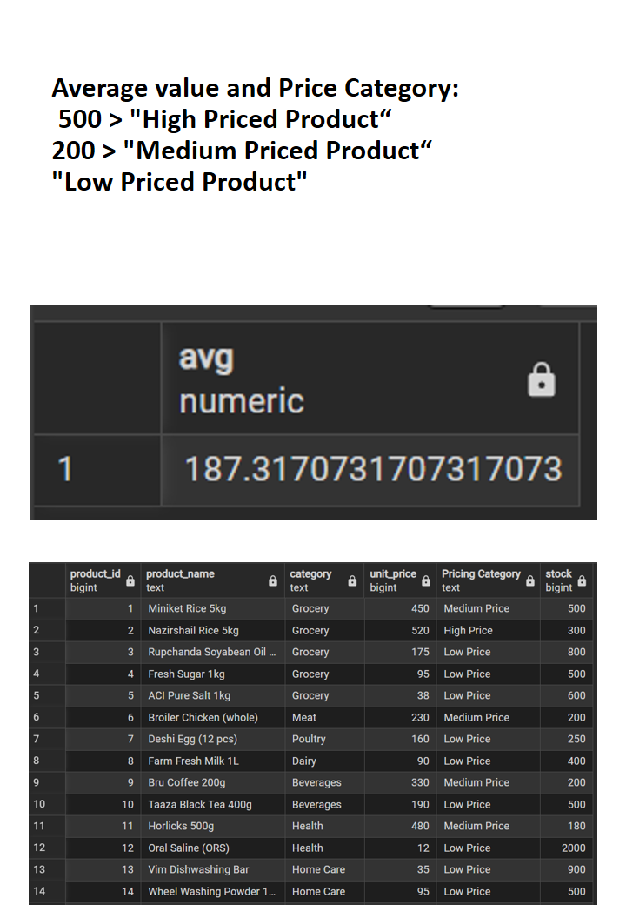
  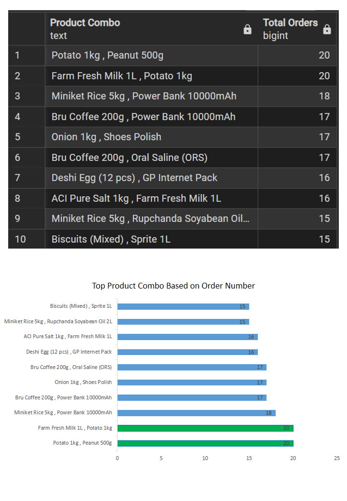
  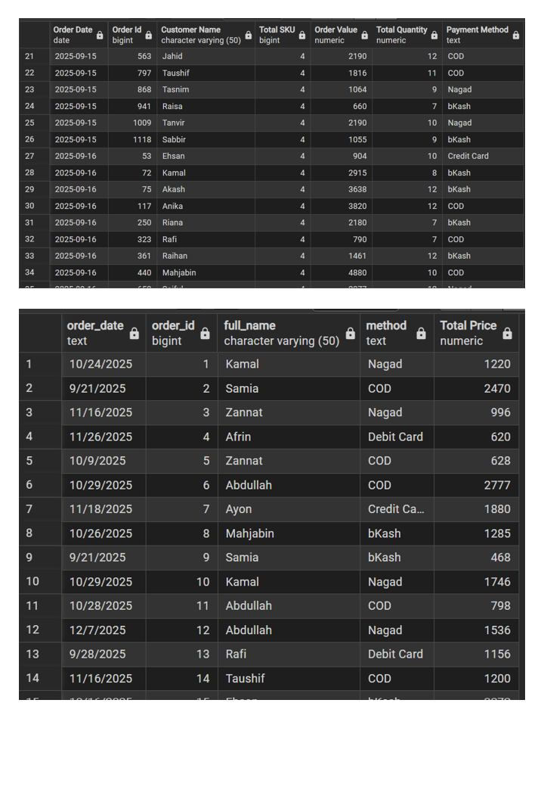
  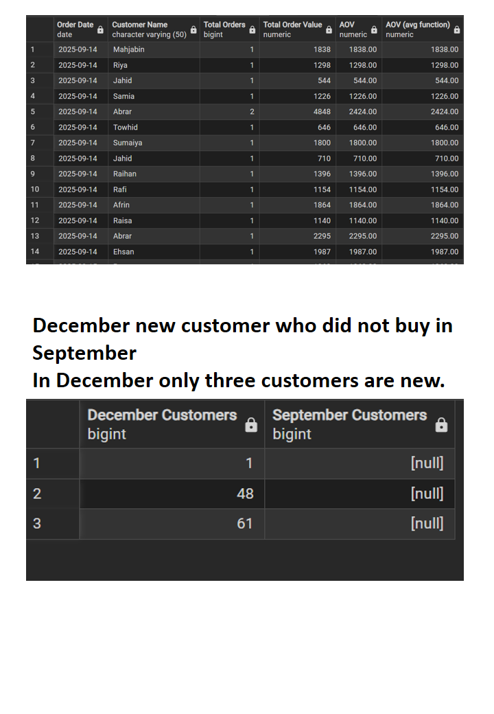
  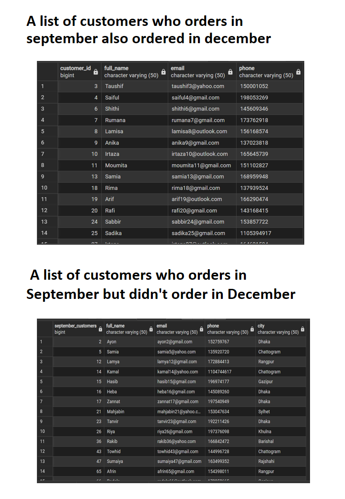

